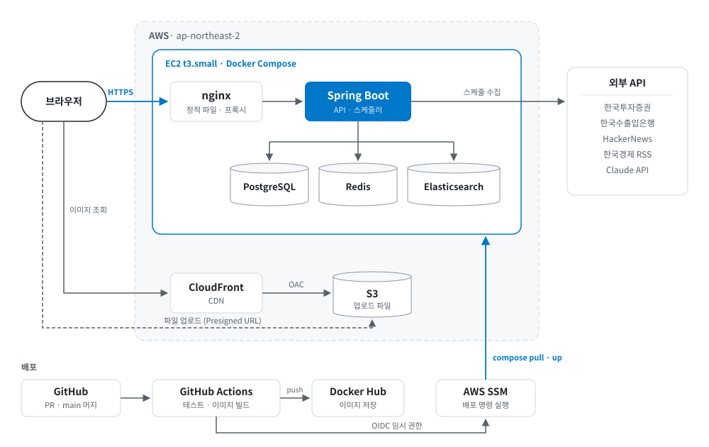

# lucium.dev

개인 기술 블로그 · https://lucium.dev

- 글 게시 기능 외에 뉴스·시장 데이터 수집 파이프라인 운영
- 수집한 데이터는 Claude API로 번역·요약
- 인프라 구축부터 배포까지 1인 운영

## 기능

- 글 작성 (Markdown, HTML 원본 게시), 태그, 댓글, RSS
- 한국어 검색 (Elasticsearch + nori)
- 뉴스·마켓
  - HackerNews, 한국경제 RSS 수집 후 제목 번역·키워드 추출
  - 국내외 지수(한국투자증권 API), 환율(수출입은행 API) 일 단위 수집
- AI 릴리즈 노트: AI 관련 소식 수집 후 일일 브리핑 생성
- 수집 현황(`/status`): 수집 작업별 실행 시각·성공 여부·실패 사유 표시
- 글 안의 코드 블록 브라우저 실행

## 구조



- 배포: PR에서 테스트·프론트 빌드 통과 → main 머지 → GitHub Actions 이미지 빌드 → SSM으로 서버 반영

## 스택

- Backend: Java 21, Spring Boot 4, Spring Security, JPA, Flyway
- Data: PostgreSQL 16, Redis 7, Elasticsearch 9
- Frontend: React, TypeScript, Vite, Tailwind CSS, TanStack Query
- Infra: AWS (EC2, S3, CloudFront), Terraform, Docker Compose, GitHub Actions

## 설계

### 배포 인증
- 기존: GitHub Secrets에 IAM 액세스 키 저장 → 유출 시 만료 없이 사용 가능
- 변경: OIDC로 배포마다 1시간 임시 권한 발급, 이 저장소 main 브랜치로만 제한

### 서버 접근
- SSH 포트 닫고 접속·배포 명령은 SSM으로 처리
- `send-command`는 비동기라 명령이 실패해도 job이 성공으로 끝날 수 있음 → 실행 완료 대기 + 결과 상태 확인 추가

### 외부 API 호출
- 응답이 수 초 걸리는 외부 호출을 트랜잭션 밖으로 분리 → 호출 중 DB 커넥션 점유 방지
- 외부 API 실패 시에도 마지막 수집 데이터 표시

### 수집 결과 기록
- 한국투자증권 API는 종목·거래소 코드 불일치 시 에러 대신 성공 코드(`rt_cd: "0"`) + 빈 응답 반환 → 정상 데이터로 오인 가능
- 수집 작업마다 결과·실패 사유 저장, `/status`에서 확인

### 조회수
- 조회마다 DB UPDATE 대신 Redis에 누적 후 주기적으로 DB 반영

### 서버 자원 (t3.small, 메모리 2GB)
- Elasticsearch 구동을 위해 스왑 2GB 추가, 커널 설정 조정
- 디스크 고갈 방지를 위해 컨테이너 로그 크기 제한

## 로컬 실행

- 필요: JDK 21, Node.js 22, pnpm, Docker

```bash
docker compose -f compose-local.yaml up -d
./gradlew bootRun --args='--spring.profiles.active=local'

cd frontend
pnpm install
pnpm dev
```


## 예정

- OpenTelemetry로 로그·트레이스 수집, Grafana 대시보드·알림 구성
- S3 접근을 액세스 키 대신 EC2 역할로 전환
